

  

  

  

<!-- ───────────── PROFILE ───────────── -->


  

<!-- ───────────── TECH ARSENAL ───────────── -->


  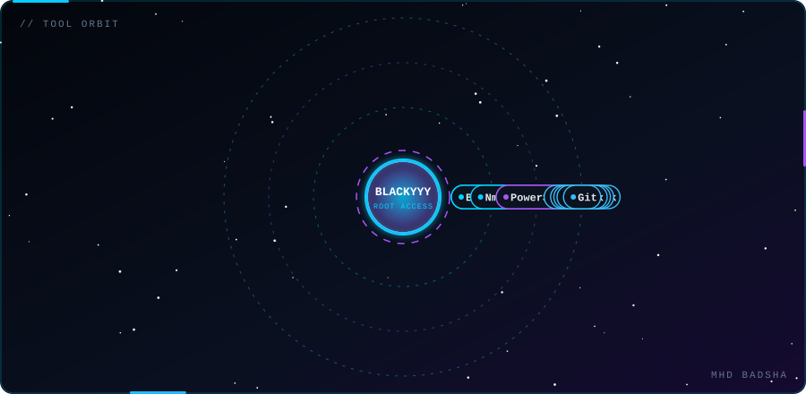

  

  

<!-- ───────────── STATS ───────────── -->

  

  

<!-- ───────────── CONTRIBUTIONS ───────────── -->


  

<!-- ───────────── PROJECTS ───────────── -->


  <a href="https://github.com/blackice-x/hexmind">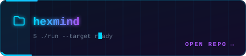</a>
  <a href="https://github.com/blackice-x/inshackle-bot">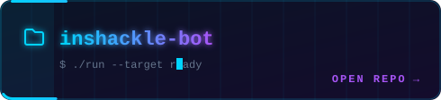</a>

  <a href="https://github.com/blackice-x/IG-blaster">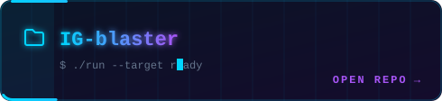</a>
  <a href="https://github.com/blackice-x/choicebot">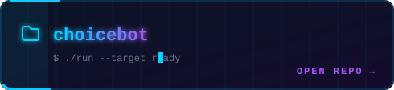</a>

<!-- ───────────── CONNECT ───────────── -->


  
  
  
  
  
  
  

  

